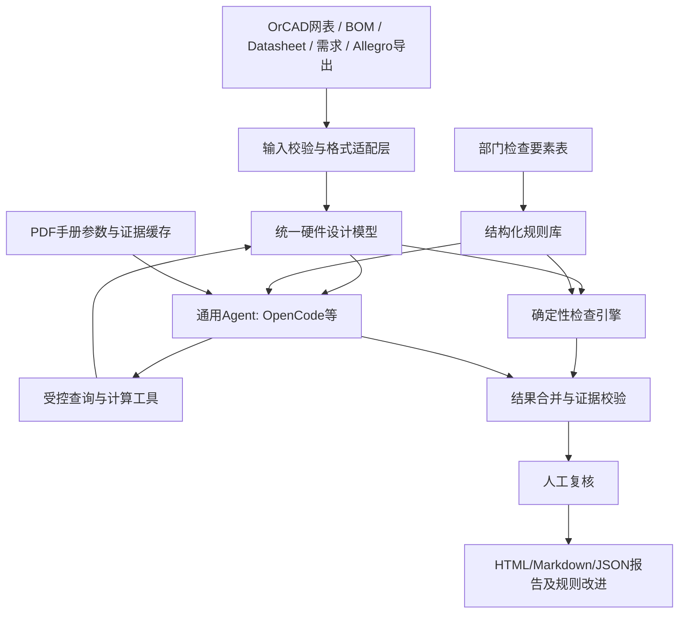

# 02. 技术架构（V0.1）

## 1. 总体方案

**形态：通用Agent + 硬件专业 Skills + Python只读工具 + 结构化规则/知识 + 可追溯审查报告。**



Agent不直接读取完整未处理巨量网表，不以模型“记忆”当做器件参数来源。原则上仅加载任务相关的模块子图、数据手册片段和规则。

## 2. 分层职责

| 层 | 建议实现 | 关键职责 | 不允许 |
|---|---|---|---|
| 输入适配 | Python脚本，沿用/参考开源解析器 | 文件完整性、编码、层次、引脚与网络、单位 | 静默忽略解析错误 |
| 统一模型 | JSON + Python数据类/图模型（可选NetworkX） | 器件、引脚、网络、PCB对象、来源映射 | 丢失原始标识或推断未提供事实 |
| 规则层 | YAML + Python确定性检测器 | 适用条件、运行前置、数值计算与门限、规则版本 | 将全部检查变为无约束自然语言 |
| Agent层 | 首先OpenCode + SKILL.md，可换Pi/Hermes/Codex | 任务分解、按需查询、语义审查、结果组织 | 未授权修改设计、运行不受限命令 |
| Datasheet层 | PDF解析+定向检索+结构化字段缓存 | 页码、表格、最小/典型/最大值及条件 | 无来源的“常识参数”作证据 |
| 校验层 | Python + 审查策略 | 位号/网络/引脚存在性、公式输入、来源、重复结果、状态 | 把模型结论当成已校验事实 |
| 结果层 | Markdown/JSON/可选HTML | 人工审核、审查版本、缺陷追踪与统计 | 输出未经复核的“设计已合格” |

## 3. 推荐的Agent调用工具（概念接口，非已实现）

```text
inspect_design()                  -> design_summary
get_component(refdes)             -> component + provenance
get_pin_net(refdes, pin)           -> net + provenance
trace_net(net_name)                -> members + aliases
get_neighborhood(refdes, depth)   -> bounded circuit subgraph
list_applicable_rules(scope)      -> rule metadata
execute_rule(rule_id, scope)      -> deterministic result
get_datasheet_parameter(mpn,key)  -> value,unit,condition,page,source
get_pcb_object(refdes/net)        -> geometry/stackup data (P2)
compare_revisions(rev_a,rev_b)    -> differences (P2)
validate_findings(findings)       -> accepted/quarantined + reasons
```

工具要求：只读、确定输入输出Schema、错误码、版本、数据来源标识、超时、有限大小返回和日志；查询对象不存在时返回明确错误，而不是空编造值。以后可统一封装为MCP Server，**但初期不强制MCP**。

## 4. 审查时序

1. 输入检查：记录文件hash、格式、编码、导出工具/版本（若可获得），拒绝未知来源的异常路径。
2. 解析/交叉校验：统计器件数、引脚连接数、网络数、BOM位号差异；对选定关键网进行人工抽查。
3. 规则适用性筛选：依据设计功能/器件类别/必要字段决定可执行和不适用规则。
4. 确定性检查：如定义好的悬空引脚规则、反馈拓扑参数计算、网络连接和BOM字段一致性。
5. Agent专项分析：仅对需要解释设计意图/器件要求的规则调用LLM；通过工具按需获得证据。
6. 证据校验：确保设计引用实际存在，参数来自正确器件及手册版本，并满足页码、数值单位与适用条件。
7. 报告与人工复核：问题状态不得自动升级为“专家确认”；将人工结论及原因用于完善规则/测试。

## 5. 推荐的判定模型

结果状态：
- `PASS`：前置条件具备、适用、已执行，且在定义的检查范围内通过；
- `FAIL`：有可复核的明确违反规则的证据（**系统判断，仍待工程师最终确认**）；
- `SUSPECTED`：AI或启发式发现疑点、尚不能排除其他合法设计意图；
- `NEEDS_REVIEW`：需要工程师确认设计假设/约束；
- `INSUFFICIENT_EVIDENCE`：缺少需求、电气参数、布局信息或手册证据；
- `NOT_APPLICABLE`：规则前置适用条件不满足；
- `ERROR`：解析或执行失败，此次规则未完成检查。

特别说明：`PASS`不是产品级设计认证，只代表单条规则在当前数据及规则版本下的结果。实际缺陷风险等级与判定状态分别存储。

## 6. 技术选型策略

- 运行平台：OpenCode作为首批实验入口；专业能力以独立目录 `SKILL.md` 和 Python脚本维护。
- AI接口：优先单位获批的内网模型；模型平台与专业工具不耦合，记录模型名称/版本和提示词/Skill修订以便复现。
- 数据：原型为本地JSON和文件系统即可；无需首期引入向量数据库/图数据库。
- 图分析：可选NetworkX；图表示保留网络/引脚/器件多关系，避免把同名网络或分层别名简单误合并。
- PDF：定向章节提取，重要图表/扫描件人工复核；参数对象存储引用页码与条件。
- PCB：优先Allegro `File → Export → IPC2581`（设计制造数据导出），按版本/配置核验实际导出对象；不足部分由SKILL辅助导出。与仅导出Cross-section的IPC-2581层叠数据**不混为一谈**。

## 7. 关键工程难点与对策

| 风险 | 缓解策略 |
|---|---|
| OrCAD多页/多单元器件/层次化网络误解析 | 构造金标准样本；比对原始网表与人工抽查连接 |
| MPN/位号/封装名称不一致 | 映射表与歧义报告；不自动覆盖 |
| PDF最小/典型/最大条件混淆 | 参数对象包含 `kind`、条件和来源；必要时人工确认 |
| LLM漏掉某些规则 | 固定规则清单由确定性工作流逐项枚举，Agent补充不替代覆盖 |
| LLM虚构器件或公式结果 | 工具返回结构化事实；校验失败隔离 |
| PCB缺层叠、走线或网名映射 | 对每项规则声明必需数据，缺项返回证据不足 |
| ERC/DRC重复造轮子 | 原生结果可作为输入，重点研究原生工具难覆盖的语义/跨域检查 |
| 离线与保密 | 默认本地只读分析；所有模型数据流通过保密批准；禁止自动上传 |

## 8. 可拓展方向

经过P1验证再决定：MCP统一工具服务、不同Agent平台适配、PCB几何/信号完整性外部仿真数据关联、ECO设计变更增量审查、问题转规则闭环、CI式设计质量门禁和可视化界面。
